  <picture>
    <source media="(prefers-color-scheme: dark)" srcset="./assets/hero-dark.svg">
    
  </picture>

  

  
  
  

---

I build on **AWS** — cloud infrastructure, networking and security — with a growing focus on **agentic AI**. 
Here on GitHub I share the practical side: hands-on cloud projects, small automation tools, and what I learn on my certification path.

  

### What Drives My Work

- **Curious about what's underneath** — how traffic finds its way, how a system stays up when one part fails, and what it really costs to run.
- **Started with automation** — small scripts for my own tasks, then a web app on the side, where I met the infrastructure behind it: databases, load balancing, scaling.
- **Now: cloud + AI agents** — systems that watch themselves, fix small problems, and leave people free for the interesting work. 

### Tech Stack

  
  
  
  
  
  
  
  
  
  

**Learning now:** 

  
  

### GitHub Activity

  
  
  
  

### Let's Connect

Studying for an AWS cert, building with AI agents, or just getting started in cloud?
I'd love to connect and learn together — say hi on [LinkedIn](https://www.linkedin.com/in/yixianlan).

 

  

